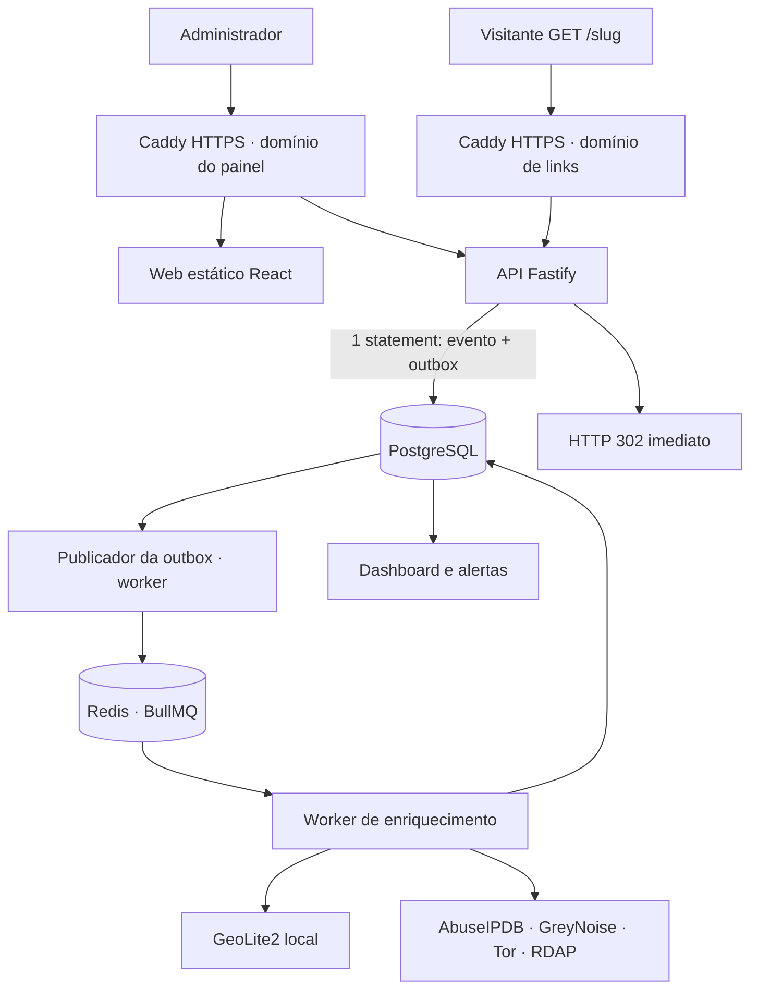
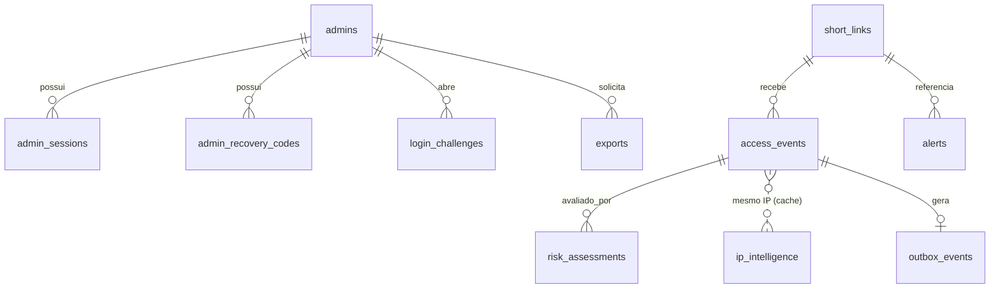

# Arquitetura

## Serviços (Compose)

| Serviço | Papel | Exposição |
|---|---|---|
| `caddy` | TLS, roteamento por domínio, cabeçalhos, sobrescreve `X-Forwarded-For` | **80/443** (único) |
| `api` | Redirect, REST administrativa, `/privacy`, health/metrics internos | rede Docker |
| `web` | SPA estática (Caddy mínimo, usuário não-root) | rede Docker |
| `worker` | Outbox→fila, enriquecimento, risco, alertas, exportações, Tor/GeoIP, expurgo | rede Docker |
| `postgres` / `redis` | Dados / fila (AOF, senha) | rede Docker, volumes |
| `geoipupdate` (perfil `geoip`) | Atualiza GeoLite2 | rede Docker |

Contêineres: `no-new-privileges`, `cap_drop: ALL` (+ mínimo necessário), `read_only` com `tmpfs`, limites de memória/CPU, healthchecks, imagens por digest, API/worker como usuário `node`.

## Fluxo do redirect (caminho crítico)

1. Valida `Host` (421 se desconhecido) e resolve o IP do cliente (`resolveClientIp`): `X-Forwarded-For` só é considerado se a conexão TCP vier do IP fixo do Caddy; percorre a cadeia da direita para a esquerda.
2. Valida o slug (alfabeto seguro, tamanho, nomes reservados) e resolve o link no **cache em memória** (TTL 30 s; cópia *stale* por até 1 h se o banco falhar).
3. 404 idêntico para inexistente/desativado/removido/expirado (sem enumeração, sem vazar destino); destino **revalidado** antes de redirecionar.
4. **Um único statement SQL** grava `access_events` + `outbox_events` (atômico) com timeout de 400 ms; falha ⇒ *fail-open* + contador `capture_failed`.
5. `302` + `Location` + `Cache-Control: no-store`. Nenhuma chamada externa e nenhum `await` de provedores TI.

## Enriquecimento (assíncrono)

Worker publica a outbox no BullMQ (`jobId` = id da outbox ⇒ idempotente; Redis fora ⇒ itens ficam pendentes). Para cada evento: ignora IP não público → GeoLite2/ASN → rDNS (timeout 2 s) → Tor → AbuseIPDB/GreyNoise (cache por IP, quota diária, circuit breaker, `Retry-After`) → risco → grava avaliação (+ alerta se *alto*). Eventos `partial` (provedor indisponível/limitado) são reenfileirados a cada 10 min por até 24 h.

## Modelo de dados (ERD)

Tabelas auxiliares: `audit_events`, `system_settings`, `telemetry_counters`, `provider_quota`, `job_state` (heartbeat, circuitos, GeoIP/Tor/expurgo), `tor_exit_nodes`. Esquema completo em [`packages/database/migrations/001_init.sql`](../packages/database/migrations/001_init.sql). Só pode haver **uma** linha com `admins.is_active` (índice único parcial).

## Segurança da camada web

Cookie de sessão `HttpOnly`, `SameSite=Strict`, `Secure` + prefixo `__Host-` em produção; token CSRF por sessão (header `X-CSRF-Token`) + checagem de `Origin`; CORS não habilitado (mesma origem); CSP restritiva no painel; `/metrics`, `/readyz`, `/healthz` bloqueados no Caddy e recusados pela API quando chamados via proxy.
